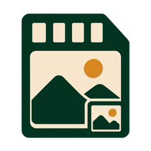
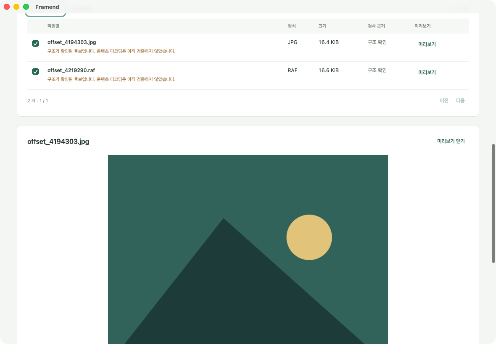

<p align="center"></p>

<h1 align="center">Framend · 프레임엔드</h1>

<p align="center"><strong>카메라 카드 이미지에서 사라진 사진을 찾고, 손상된 영상에서 재생 가능한 구간을 건져냅니다.</strong><br>Windows와 macOS에서 원본을 읽기 전용으로 열고, 복구 결과를 새 폴더에 저장합니다.</p>

<p align="center">
  <a href="https://github.com/qkdeoddl12/Framend/releases/download/v0.1.0/Framend-Windows-x64-setup.exe"><b>Windows x64</b></a> ·
  <a href="https://github.com/qkdeoddl12/Framend/releases/download/v0.1.0/Framend-macOS-Apple-Silicon.dmg"><b>Mac (Apple silicon)</b></a> ·
  <a href="https://github.com/qkdeoddl12/Framend/releases/download/v0.1.0/Framend-macOS-Intel.dmg"><b>Mac (Intel)</b></a> ·
  <a href="README.md">English</a>
</p>



## 예제 카드로 써보기

1. 위에서 **0.1.0 프리뷰**를 내려받습니다. Windows 11 x64에서는 설치 프로그램을 실행합니다. macOS 14 이상에서는 DMG를 열고 Framend를 응용 프로그램 폴더로 옮깁니다. Mac의 칩 종류는 **Apple 메뉴 → 이 Mac에 관하여**에서 확인할 수 있습니다.
2. [예제 카드](https://github.com/qkdeoddl12/Framend/releases/download/v0.1.0/Framend-demo-card.zip)의 압축을 풉니다. **파일 복구**에서 `demo-card.img`를 선택하고 **내용 기반 검색 → 파일 검색**을 누릅니다.
3. JPEG를 미리 보고 복구할 항목을 고릅니다. 저장 폴더를 정하고 **선택 복구**를 누르면 새 폴더에 결과가 생깁니다. 예제에는 풍경 그림 한 장과 그 JPEG를 미리보기로 담은 합성 Fujifilm RAF가 들어 있습니다.

실제 카드에는 먼저 만들어 둔 디스크 이미지(`.img`, `.dd`, `.raw`)를 사용하고, 결과는 다른 드라이브에 저장하세요. Windows 설치 파일은 서명 전이고 Mac 배포본은 로컬 서명을 사용합니다. Mac에서 첫 실행이 차단되면 **시스템 설정 → 개인정보 보호 및 보안 → 그래도 열기**에서 이 앱을 허용할 수 있습니다. [릴리스 파일과 SHA-256 체크섬](https://github.com/qkdeoddl12/Framend/releases/tag/v0.1.0)


## 어떤 경우에 쓸 수 있나요?

| 가지고 있는 파일 | 할 수 있는 일 |
| --- | --- |
| 파일 목록을 잃은 카드 이미지 | 연속해서 남은 JPEG·PNG·Fujifilm RAF·WAVE의 구조를 찾아 추출합니다. JPEG·PNG와 RAF 안의 JPEG는 미리 볼 수 있습니다. |
| 파일 정보가 남은 exFAT 이미지 | MOV·MP4·문서·압축 파일 등을 원래 바이트 순서대로 추출합니다. 원래 이름과 폴더를 찾으면 보고서에 함께 기록합니다. |
| 손상된 H.264·HEVC 영상과 같은 설정의 정상 참고 영상 | 두 영상을 비교해 복구 가능한 영상 구간을 별도 파일로 저장합니다. 음성과 원래 시간 정보는 복원하지 못합니다. FFmpeg와 ffprobe가 필요합니다. |
| 복구 결과의 근거가 필요한 경우 | JSON 보고서에서 원본 바이트 위치, 출력 SHA-256, 구조·디코딩 검사 결과를 확인할 수 있습니다. 검사하지 못한 파일과 미완료 세션도 표시합니다. |

## 현재 지원과 한계

- 입력은 일반 파일만 허용. 장치·FIFO·심볼릭 링크는 엔진에서 거부합니다.
- 원본을 읽기 전용으로 열고 원본 변경을 검사합니다. 출력은 매번 새 디렉터리와 새 파일로 작성합니다.
- 내용 기반 탐색은 연속 JPEG/RAF/PNG와 RIFF/WAVE를 지원합니다. JPEG/RAF/PNG는 512 MiB, WAVE는 RIFF의 32비트 길이 범위까지이며 후보는 최대 100,000개입니다. 공통 앱의 이미지 미리보기는 32 MiB·80 MP까지입니다.
- PNG는 청크 순서·길이·CRC를 검사합니다. APNG 애니메이션은 내용 기반 탐색 대상이 아닙니다. WAVE는 청크·PCM 정렬 등을 검사하며 구조 검사만으로 음성 디코딩 성공을 표시하지 않습니다.
- exFAT 파일 메타데이터가 남은 경우 문서·압축·오디오·다른 카메라 RAW 등도 종류와 무관하게 추출합니다. 내부 형식 전용 검사가 없는 파일은 **미검증**입니다. 이름과 폴더 정보는 보고서에 보존하고, 출력은 안전하게 생성한 파일명을 사용합니다.
- RAF는 유효한 내장 JPEG와 겹치지 않는 헤더 범위를 확인한 뒤 추출합니다. 내장 JPEG가 손상된 RAF는 아직 지원하지 않습니다. **RAW 전체 디코딩 미검증**이며 내장 JPEG 미리보기와 구별합니다.
- 디코딩 통과는 디코더가 내용을 끝까지 읽었다는 뜻이며 원본과 동일함을 보증하지 않습니다. 공통 앱은 설치된 FFmpeg/ffprobe를 검사에 사용하고, 도구가 없으면 해당 검사 수준을 낮춰 표시합니다. RAW 전체 디코딩은 하지 않습니다.
- 내용 기반 탐색에서는 삭제 여부·원래 이름·폴더를 알 수 없으며, 존재하는 사진도 발견됩니다. exFAT 모드는 남은 메타데이터가 있을 때 해당 정보를 사용합니다.
- `.dmg` 압축 컨테이너, 앱 안에서의 물리 SD카드 복제, FAT32/GPT/NTFS/APFS 분석, 메타데이터가 사라진 임의 조각 재배열, HEIF·PDF·ZIP·다른 RAW의 내용 기반 탐색은 아직 지원하지 않습니다.
- 실제 X-T5 카드에서 사진 후보 검출과 별도 RAW 검증을 수행했습니다. 이 앱의 RAF 검증은 여전히 구조 검사이며, 전체 카드에 대한 복구율이나 모든 압축 RAW 모드 호환성은 확정하지 않았습니다.
- Mac 배포 대상은 macOS 14 이상입니다. Apple silicon과 Intel용 앱을 각각 제공합니다.

## 영상 복구 상세

영상 기능에는 `ffmpeg`와 `ffprobe`가 필요합니다 (`brew install ffmpeg`). 영상 수리 알고리즘은 자체 Rust 코드이고, FFmpeg는 컨테이너 저장과 독립 디코딩 검사에 사용합니다.

- **카드 이미지에서 영상 찾기:** exFAT 파일 목록·FAT 체인·할당 비트맵을 검사해 MOV/MP4 후보를 표시합니다. 선택한 후보의 원래 바이트 순서를 복원하고 모든 영상·음성 트랙을 끝까지 디코딩합니다. 저장 폴더는 외장 SSD를 선택하세요.
- **손상 영상 수리:** 손상 MOV/MP4와 같은 카메라·코덱·해상도·프레임 속도의 정상 참고 영상을 선택합니다. H.264/HEVC NAL 구조와 IDR 시작점을 검사해 남은 영상 프레임을 추출합니다. **영상 트랙만 부분 복구**하며 음성과 원래 타임스탬프는 복원하지 않습니다. 재생 속도는 참고 영상의 평균값입니다.
- **끊어진 구간 분리:** 알 수 없는 바이트 뒤에서 다시 찾은 영상 구간은 각각 별도 파일로 저장하고 검사합니다. 한 구간의 디코딩 실패가 다른 구간의 결과를 덮어쓰지 않습니다. 구간 번호는 발견 순서이며 촬영 순서가 아닙니다. 최대 256개 구간이며 초과하면 명시적으로 중단합니다.
- 결과는 매번 새 `Framend-*` 폴더에 저장됩니다. `results.json`, 원본 위치/해시 보고서, 도구 정보, 트랙별 프레임 해시와 오류 로그를 보존합니다. 중단·실패·디코딩 오류가 있으면 `INCOMPLETE.txt`를 유지합니다.
- `native-report.json`의 `segment_map`은 각 구간의 중간 파일 범위·SHA-256·원본 위치 목록·종료 사유를 담습니다. `segment-NNNN-result.json`은 개별 검사 결과와 연결됩니다. `salvaged.es`는 구간들을 담은 중간 증거 파일이며, 하나의 원래 영상이라는 뜻이 아닙니다. 잘린 NAL이 뒤의 알 수 없는 바이트를 포함하면 디코딩을 통과해도 마지막 프레임의 픽셀이 달라질 수 있습니다.
- `전체 디코딩 통과`는 디코더가 트랙을 읽었다는 의미입니다. 원본의 완전성·장면 순서·조각의 동일 출처까지 증명하지 않습니다. NAL 수리는 디코딩을 통과해도 항상 부분 복구로 표시합니다.
- 일부 B프레임 배열에서는 원래 시간값을 잃은 뒤 재생 시간 순서를 구성하지 못합니다. 현재 그런 결과는 검사 실패로 표시하고 원시 영상 데이터와 로그를 남깁니다. 모든 H.264·HEVC 촬영 설정을 지원하는 것은 아닙니다.

exFAT는 단일 FAT의 1.00 볼륨/MBR만 지원합니다. 삭제된 폴더, 사라진 FAT 체인, 미초기화된 파일 끝은 추정하지 않습니다. NAL 수리는 지원되는 progressive H.264 / single-layer HEVC에 한정되며 IDR에서만 시작·재시작합니다. 손상·알 수 없는 바이트 뒤의 종속 프레임은 건너뜁니다. 메타데이터와 프레임 경계가 모두 사라진 일반적인 단편화 복구는 후속 연구 범위입니다.

구간 수리의 사전 공간 검사는 입력 크기의 3배에 매개변수·컨테이너 여유 1GiB와 기존 여유 64MiB를 더한 값입니다. 중간 데이터·분리 데이터·MP4와 검사 기록을 모두 선택한 저장 폴더에 남깁니다.

[재현 가능한 검증 결과](docs/native-video-validation.md) · [논문 근거와 AI 도입 실험안](docs/research/native-video-and-ai.md). AI 모델은 아직 탑재하지 않았습니다.

## 개발·검증

공통 앱 배포 빌드에는 Rust 1.99.1과 Node.js 24를 사용합니다. 기존 맥 앱은 Swift 6 이상과 macOS Command Line Tools가 필요합니다.
설치된 Swift 6.3.1과 Rust 1.99.1을 사용합니다. 셸 PATH에 cargo가 없다면 `$HOME/.cargo/bin/cargo`를 사용하세요.

```sh
cargo test --manifest-path engine/Cargo.toml
cargo clippy --manifest-path engine/Cargo.toml --all-targets -- -D warnings
swift scripts/make-demo.swift
bash scripts/build-app.sh
swift run RecoveryChecks --integration --broken-pipe --bad-json --video --video-process
python3 scripts/smoke-test.py
python3 scripts/test-desktop-jobs.py --engine engine/target/release/recovery-engine --output-root /path/to/existing/output
```

Xcode 전체가 없는 환경에서도 실행할 수 있도록 Swift 검사는 의존성이 없는 실행형 테스트 하네스를 사용합니다.
`fixtures/generated/demo-card.img`를 앱에서 열면 실제 JPEG와 테스트용 합성 RAF를 복구해 볼 수 있습니다.

## 구조

- `engine/`: Rust 파일 파서, 스트리밍 검색, 변경 감지, 안전한 추출, JSON Lines CLI.
- `desktop/`: Tauri 공통 앱, 한국어·영어 화면, 작업 프로세스 실행·취소.
- `Sources/RecoveryCore/`: 엔진 통신과 프로토콜 검증, ImageIO 검사.
- `Sources/RecoveryCard/`: SwiftUI 앱과 작업 상태.
- `docs/design.md`: 이번 범위와 후속 개발 단계.

서드파티 복구 엔진이나 LibRaw를 포함하지 않습니다. FFmpeg 실행 파일도 번들하지 않습니다. 의존성과 라이선스는 각 Cargo/npm 잠금 파일 및 프로젝트를 참고하세요. [데스크톱 빌드 안내](desktop/README.md) · [macOS 및 Windows 검사 결과](https://github.com/qkdeoddl12/Framend/actions/workflows/checks.yml)
