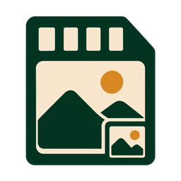
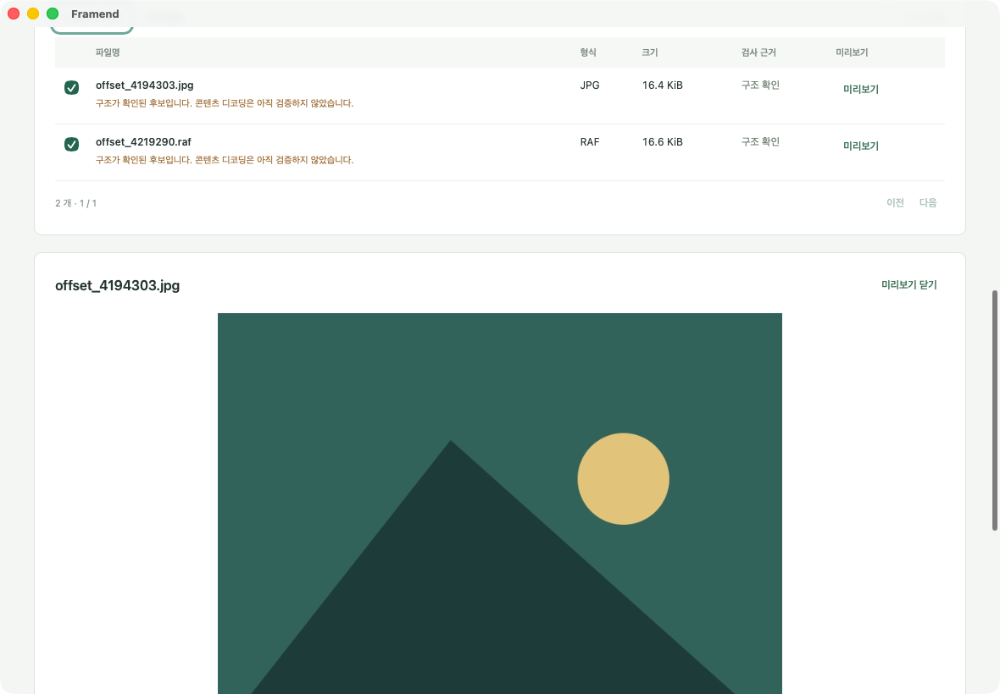

<p align="center"></p>

<h1 align="center">Framend</h1>

<p align="center"><strong>Find photos on a camera card image. Save the playable parts of a damaged clip.</strong><br>Framend opens the source read-only and saves recovered files to a new folder on your computer.</p>

<p align="center">
  <a href="https://github.com/qkdeoddl12/Framend/releases/download/v0.1.0/Framend-Windows-x64-setup.exe"><b>Windows x64</b></a> ·
  <a href="https://github.com/qkdeoddl12/Framend/releases/download/v0.1.0/Framend-macOS-Apple-Silicon.dmg"><b>Mac (Apple silicon)</b></a> ·
  <a href="https://github.com/qkdeoddl12/Framend/releases/download/v0.1.0/Framend-macOS-Intel.dmg"><b>Mac (Intel)</b></a> ·
  <a href="README.ko.md">한국어</a>
</p>



## Try it with a demo card

1. Install the **0.1.0 preview**. On Windows 11 x64, run the setup program. On macOS 14 or later, open the DMG and drag Framend into Applications. You can check your Mac’s chip under **Apple menu → About This Mac**.
2. Download and unzip the [demo card](https://github.com/qkdeoddl12/Framend/releases/download/v0.1.0/Framend-demo-card.zip). Choose **English** in the top-right language menu. In **File recovery**, choose `demo-card.img`, leave **Content signatures** selected, and click **Scan files**.
3. Preview the JPEG, select the files you want, choose an output folder, and click **Recover selected**. The demo includes a landscape drawing and a synthetic Fujifilm RAF containing the same JPEG preview.

For your own card, use a flat disk image such as `.img`, `.dd` or `.raw` and save the results to another drive. Framend works locally. The preview is unsigned on Windows and ad hoc signed on macOS. macOS may require **System Settings → Privacy & Security → Open Anyway** after the first launch attempt. [Release files and SHA-256 checksums](https://github.com/qkdeoddl12/Framend/releases/tag/v0.1.0)


## What can I recover?

| What you have | What Framend can do |
| --- | --- |
| A card image with a missing directory | Find contiguous JPEG, PNG, Fujifilm RAF and RIFF/WAVE files by their contents. Preview JPEG, PNG and the JPEG embedded in a RAF. |
| An exFAT image with surviving file records | Use the recorded extents to extract files, including MOV/MP4, documents and archives. Where available, the report preserves original names and paths. |
| A damaged H.264 or HEVC clip and a healthy clip from the same camera | With matching recording settings, extract independently playable video segments. This is partial recovery. Audio and original timestamps are lost. FFmpeg and ffprobe are required. |
| Recovered files you need to check | Inspect the JSON report for source byte ranges, output SHA-256 hashes and validation results. Unverified files and incomplete sessions are labeled. |

The exFAT reader supports single-FAT exFAT 1.00 volumes and MBR partitions. FAT32, GPT, NTFS and APFS metadata recovery are outside this preview. An embedded RAF preview checks only the JPEG. A complete RAW decode or an original file for comparison provides stronger evidence.

## Build and verify

The shared desktop app uses Tauri and a Rust worker. Release builds use Rust 1.99.1 and Node.js 24. FFmpeg and ffprobe are optional for ordinary file extraction. If you need video repair, install both tools and select their executables in the app if they are outside its PATH.

```sh
git clone https://github.com/qkdeoddl12/Framend.git
cd Framend/desktop
npm ci
npm run desktop:dev
```

[Native build instructions](desktop/README.md) · [Recovery test results](docs/cross-platform-validation.md) · [Video validation](docs/native-video-validation.md) · [GitHub checks](https://github.com/qkdeoddl12/Framend/actions/workflows/checks.yml)
